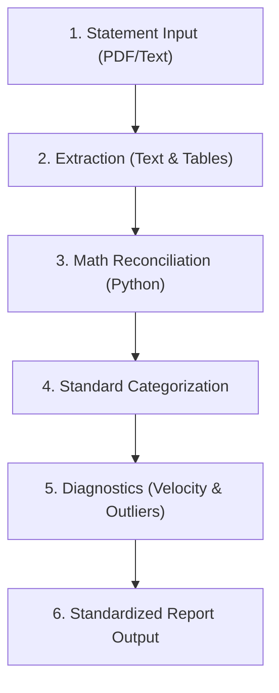

# 💳 Credit Card Statement Analyzer

A reusable, bank-agnostic skill to parse credit card statements, verify mathematical accuracy, categorize transactions into standard financial buckets, and generate clean spending reports with micro-transaction velocity insights.

---

## 1. Analysis Workflow

Follow this 5-step runbook whenever a statement is provided:



### Step 1: Ingestion & Text Extraction
- For PDF files, extract page text and tables using Swift PDFKit or Python.
- Retrieve key statement metadata:
  - **Issuer / Card Name** (e.g., ttb so fast, UOB Premier)
  - **Cardholder Name** & **Masked Card Number**
  - **Statement Date** & **Payment Due Date**
  - **Total Balance Due** & **Minimum Payment Due**
  - **Previous Balance** & **Previous Payments Received**
  - **Reward Points** (earned this cycle and total balance)

### Step 2: Mathematical Verification
Always verify numbers using Python before reporting. Ensure:
1. `Net New Spend = Sum of Purchases - Merchant Reversals - Cashbacks`
2. `Total Balance Due == Previous Balance - Payments + Net New Spend + Interest/Fees`
3. Identify 0% Installment components (e.g. `001/010`, `002/003`) which are typically billed at 100% in minimum payment calculations.

### Step 3: Categorize Transactions
Classify each item into standard categories using [references/thai_merchants.md](./references/thai_merchants.md):
1. **🚆 Transportation & Commute**: BTS, MRT, ARL, Grab, Expressways, Fuel stations.
2. **🛒 Groceries & Convenience**: 7-Eleven, Mini Big C, Tops, Lotus's, Super Turtle, Big C.
3. **🍽️ Food & Dining**: Dine-in restaurants, fast food, bakeries, cafes, food delivery.
4. **📱 Subscriptions & Telco**: Streaming (Spotify, Netflix, YouTube), cloud storage, telco bills.
5. **🏋️ Fitness & Health**: Gym memberships, sports nutrition, sports equipment.
6. **🛍️ Shopping & Lifestyle**: Department stores, fashion/apparel, electronics, books.
7. **🔄 Active 0% Installments**: Plans with installment fraction counters (`xxx/xxx`).
8. **💳 Payments & Credits**: Payments from prior cycle, cashbacks (`CB`), refund reversals (`CR`).

### Step 4: Run Diagnostics (Velocity & Outliers)
- **Micro-spending Velocity**: Group vendors with $\ge 3$ visits under 200 THB (e.g., 7-Eleven 44 visits) to compute total spend, frequency, and average ticket size.
- **Big-Ticket Outlier Alert**: Flag single positive purchases $\ge 5,000\text{ THB}$ so the user can verify if they qualify for 0% installment conversions in their banking app.

---

## 2. Standard Output Report Template

Produce the output using this markdown structure:

````markdown
# 📊 Credit Card Statement Analysis: [Bank / Card Name]
**Statement Date:** [DD MMM YYYY] | **Payment Due Date:** [DD MMM YYYY]  
**Total Balance Due:** [X,XXX.XX THB] | **Total New Spend:** [X,XXX.XX THB]

---

### 1. Executive Summary Table
| Category | Tx Count | Total (THB) | % of Total Spend | Notes / Highlights |
| :--- | :---: | :---: | :---: | :--- |
| 1. Transport & Commute | X | XXX.XX | XX% | [BTS, MRT, Grab, Fuel] |
| 2. Groceries & Convenience | X | XXX.XX | XX% | [7-Eleven, Tops, Big C] |
| 3. Food & Dining | X | XXX.XX | XX% | [Restaurants & Cafes] |
| 4. Subscriptions & Bills | X | XXX.XX | XX% | [Digital services] |
| 5. Fitness & Health | X | XXX.XX | XX% | [Gym, Supplements] |
| 6. Shopping & Retail | X | XXX.XX | XX% | [Malls, Fashion, Hardware] |
| 7. Active 0% Installments | X | XXX.XX | XX% | [Active plans: xxx/xxx] |
| 8. Payments & Credits | X | -XXX.XX | - | [Prior payment & cashbacks] |
| **Total Billed Balance** | **X** | **X,XXX.XX** | **100%** | Due on [DD MMM YYYY] |

---

### 2. Category Detail Breakdown
*(List items grouped by category with dates and amounts. Group high-frequency micro-spends into summary bullets).*

---

### 3. Spending Diagnostics & Insights
1. **Micro-Spending Velocity:**
   - Vendor frequency (e.g. 7-Eleven: X visits, total X THB, avg X THB/visit).
2. **Big-Ticket & Outlier Flags:**
   - Any transactions $\ge 5,000\text{ THB}$ flagged for potential 0% installment conversion.
3. **Cashback & Fee Check:**
   - Total cashback/rebates earned (`-XX.XX THB`).
   - Interest and finance fees check (0 THB if fully paid).
````

---

## 3. Helper Tools & References
- **Analysis Script:** Use [scripts/parse_statement.py](./scripts/parse_statement.py) for programmatic grouping and calculation.
- **Thai Merchant Reference:** Consult [references/thai_merchants.md](./references/thai_merchants.md) for merchant pattern resolutions.
